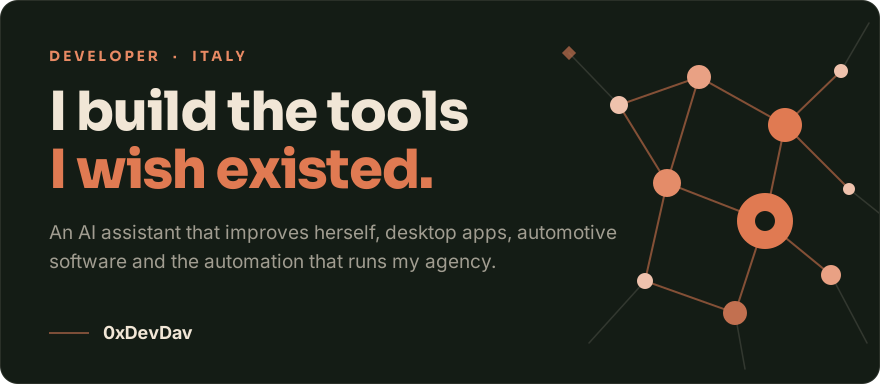
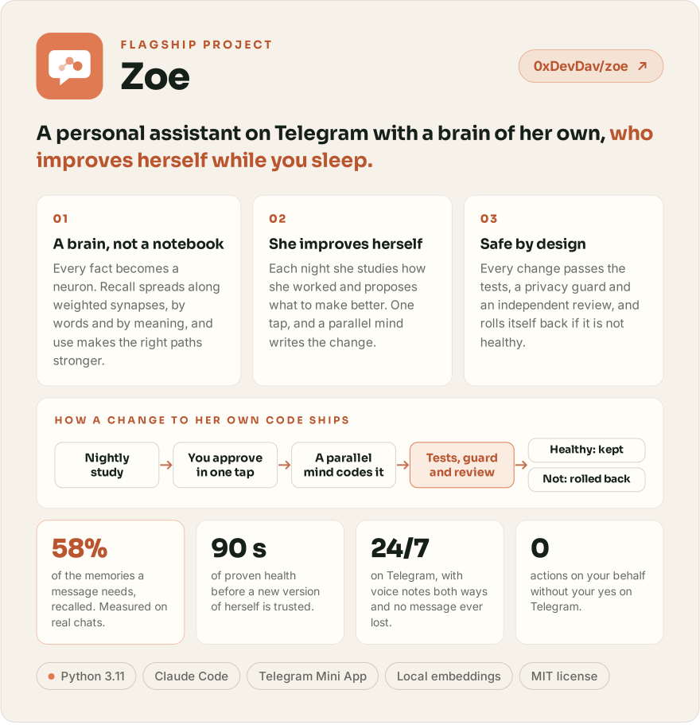
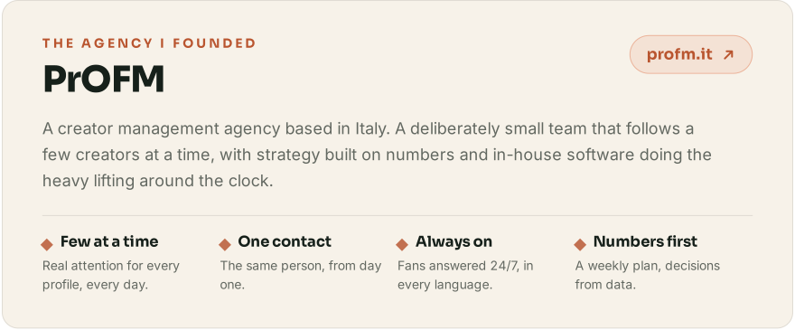
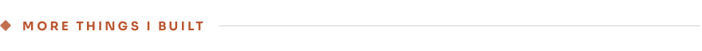
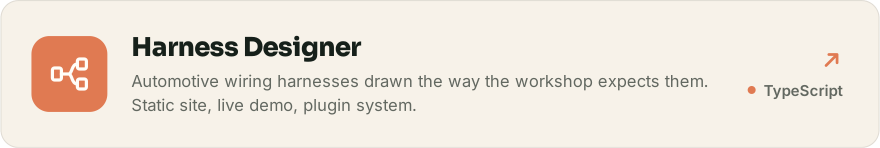
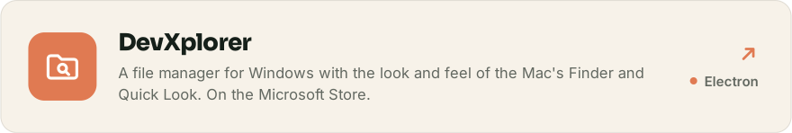
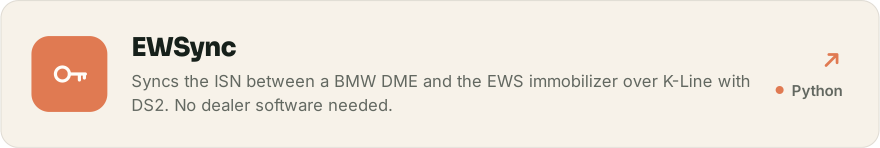
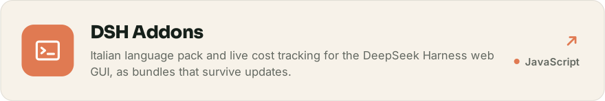
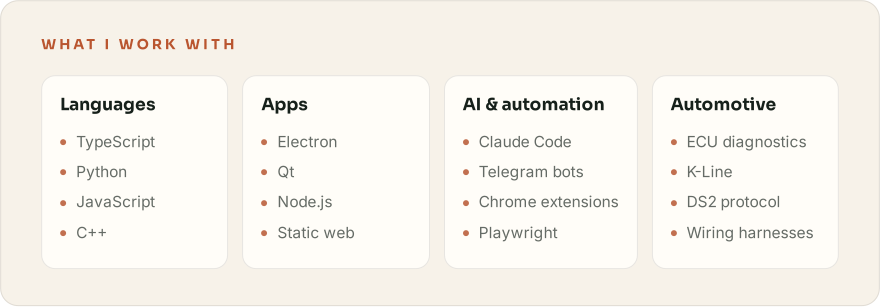
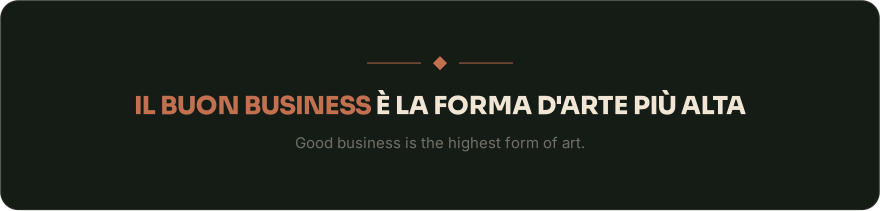

<!-- Graphics generated from strumenti/github-profilo/sorgente: do not edit the SVGs by hand. -->

<picture>
  <source media="(prefers-color-scheme: dark)" srcset="assets/banner-dark.svg">
  
</picture>

<a href="https://github.com/0xDevDav/zoe">
<picture>
  <source media="(prefers-color-scheme: dark)" srcset="assets/zoe-dark.svg">
  
</picture>
</a>

<a href="https://profm.it">
<picture>
  <source media="(prefers-color-scheme: dark)" srcset="assets/profm-dark.svg">
  
</picture>
</a>

<picture>
  <source media="(prefers-color-scheme: dark)" srcset="assets/titolo-progetti-dark.svg">
  
</picture>

<a href="https://github.com/0xDevDav/harness-designer">
<picture>
  <source media="(prefers-color-scheme: dark)" srcset="assets/harness-designer-dark.svg">
  
</picture>
</a>

<a href="https://github.com/0xDevDav/devxplorer">
<picture>
  <source media="(prefers-color-scheme: dark)" srcset="assets/devxplorer-dark.svg">
  
</picture>
</a>

<a href="https://github.com/0xDevDav/EWSync">
<picture>
  <source media="(prefers-color-scheme: dark)" srcset="assets/ewsync-dark.svg">
  
</picture>
</a>

<a href="https://github.com/0xDevDav/dsh-addons">
<picture>
  <source media="(prefers-color-scheme: dark)" srcset="assets/dsh-addons-dark.svg">
  
</picture>
</a>

<picture>
  <source media="(prefers-color-scheme: dark)" srcset="assets/stack-dark.svg">
  
</picture>

  Write to me on <a href="https://t.me/Devdaatson">Telegram</a> or open an issue on any project.

<picture>
  <source media="(prefers-color-scheme: dark)" srcset="assets/footer-dark.svg">
  
</picture>
